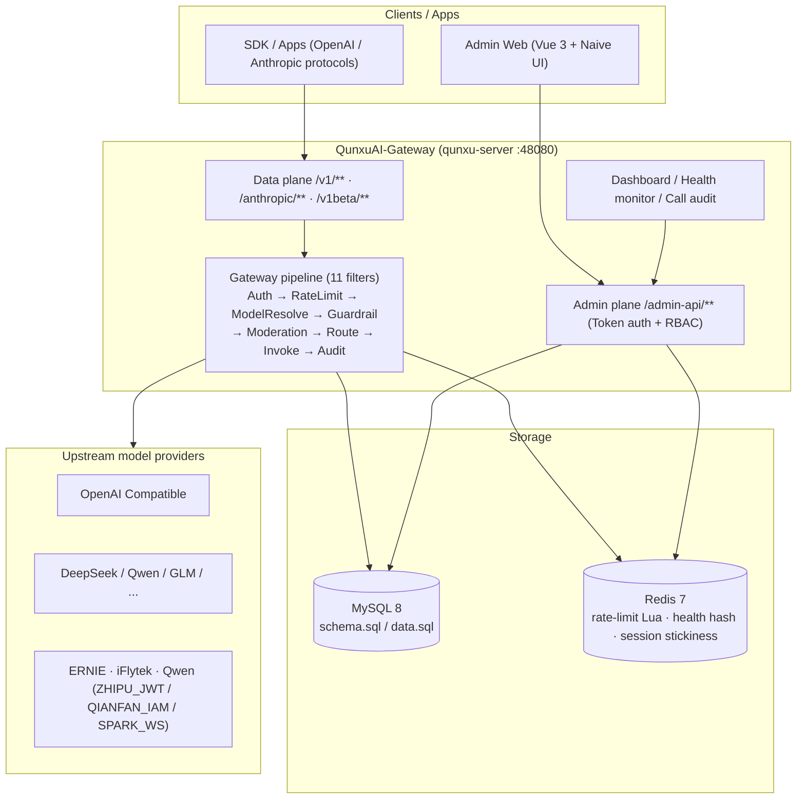
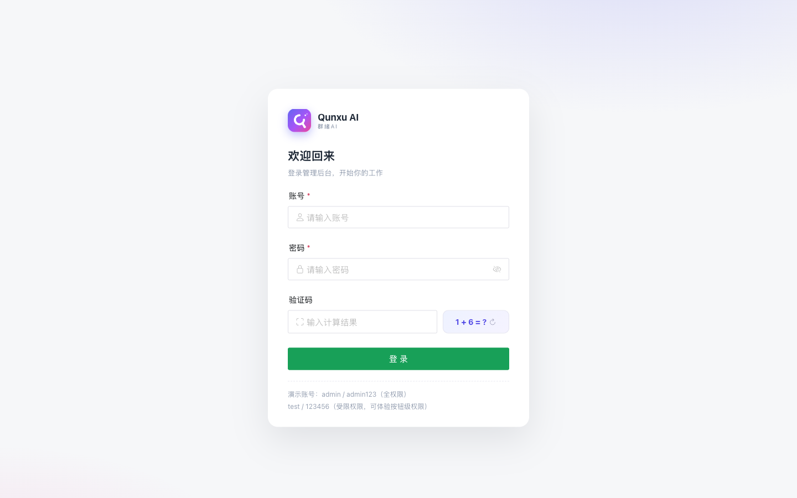
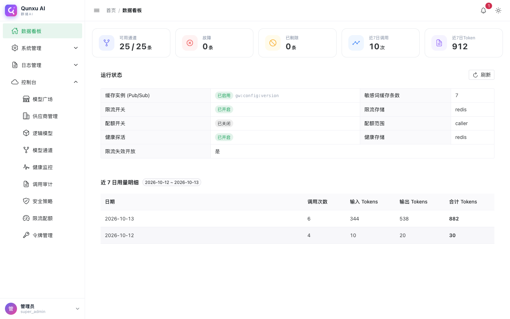
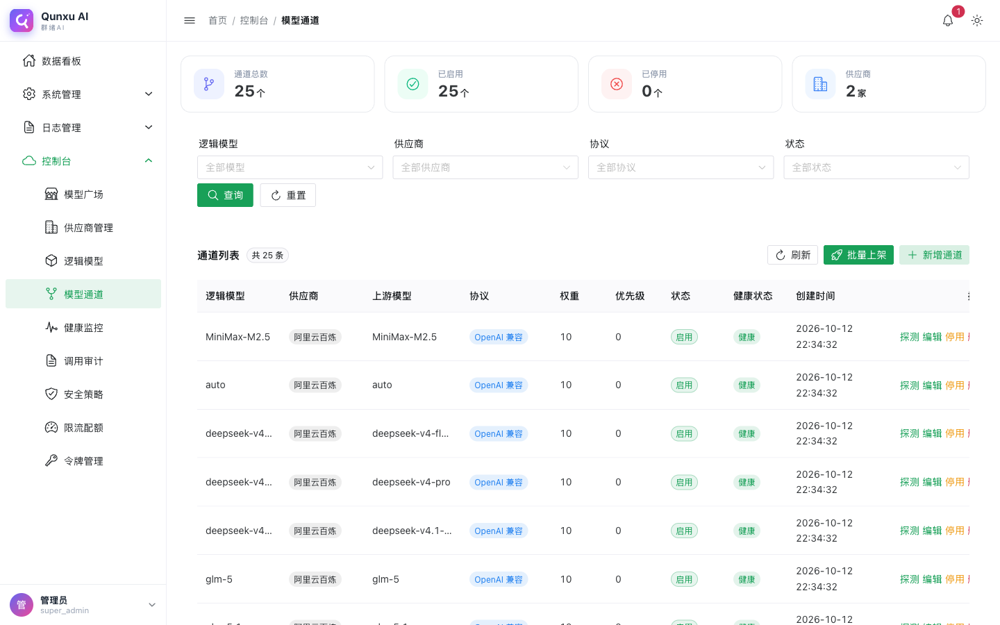
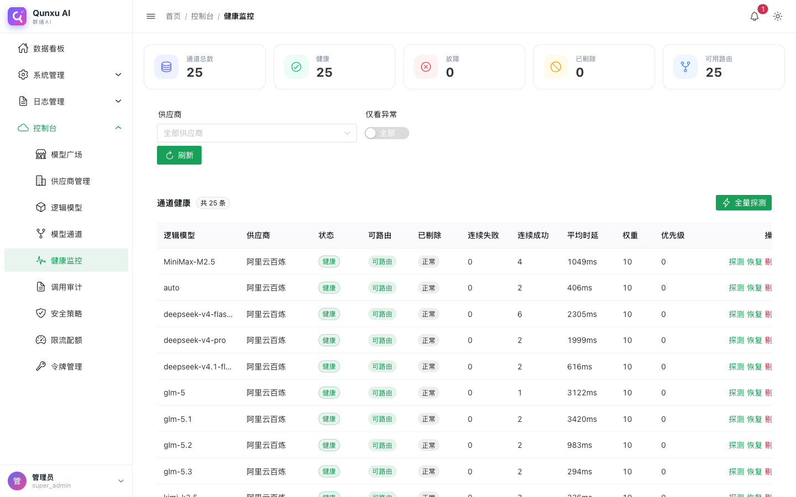

# QunxuAI-Gateway (Model Gateway)

<p align="center">
  <a href="README.md">简体中文</a> · <b>English</b>
</p>

[](LICENSE)
[]()
[]()
[]()
[](https://github.com/QunxuAI/qunxu-ai-gateway)
[](https://hub.docker.com/r/qunxuai/qunxu-ai-gateway)

**QunxuAI-Gateway** is a **unified model gateway** for LLM applications, shipped with a full admin console (multi-tenant / user / permission / menu):

- The **admin plane** provides login, permission, menu, tenant, and user management capabilities out of the box;
- The **data plane** provides multi-protocol compatible entry points — OpenAI / Anthropic / Gemini / OpenAI Responses — with unified routing to LLM providers;
- The **frontend** is built with Vue 3 + Naive UI, providing gateway management pages: dashboard, providers, logical models, model channels, health monitor, audit logs, security policies, rate limits, API keys, and model plaza.

> Single-repo Maven multi-module project. `qunxu-module-gateway` is the core model-gateway module, `qunxu-server` is the bootstrap entry, and `qunxu-ui` is the admin frontend.

---

## ✨ Features

| Feature | Description |
| --- | --- |
| Multi-protocol data plane | OpenAI (`/v1/**`), Anthropic (`/anthropic/**`), Gemini (`/v1beta/models/{model}:generateContent` / `:streamGenerateContent`), OpenAI Responses (`/v1/responses`) |
| Provider / Model / Channel | Provider credentials (BEARER / ZHIPU_JWT / QIANFAN_IAM / SPARK_WS), unified logical models, weighted round-robin load balancing across channels |
| Batch model onboarding | Fetch upstream `GET /models`, auto-detect capability (CHAT / EMBEDDING / RERANK / TTS / STT / IMAGE), bulk-create channels and auto-reuse same-name logical models |
| Session-level provider stickiness | A session (caller + `X-Session-Id`) pins to the first selected channel (Redis binding + TTL auto-expiry), auto-rebinds on channel failure |
| P0 reversible masking | Guardrail masking in `star` (same-length `*`) or `placeholder` (`{{PHONE_1}}` + local restoration) modes; real values live only in memory |
| P1 protocol-aware protection | Anthropic thinking blocks (with signature) and OpenAI `reasoning_content` are marked protected — excluded from guardrails/moderation and passed through untouched |
| Health self-healing | Channel health probing (reactive Redis), auto eject / recover (EJECT / RECOVER), health event history |
| Guardrails | Sensitive words (built-in seed + DB merge), PII masking, input length limits, prompt-injection detection; BLOCK / MASK / WARN actions |
| Content moderation | Built-in keyword moderation, extensible (aliyun / llm); BLOCK / REVIEW / PASS |
| Rate limit & quota | Per-caller / per-model / per-tenant rate limiting (Redis Lua token bucket) + daily token quota |
| Call audit | Full logs of tokens / latency / first-token latency / truncated & masked request-response bodies / traceId / guardrail & moderation hits |
| Dual-perspective menus | Super admin sees the full admin menu; the common role sees only Dashboard + API Keys + Model Plaza (data isolated per caller, enforced at the API layer) |

## 🏗️ Architecture

| Item | Description |
| --- | --- |
| Base framework | Spring Boot 4.1.1 (Spring Framework 7), Java 21 (LTS), Maven multi-module |
| Application model | Servlet (WebMVC) primary; gateway keeps its reactive internals (Mono/Flux, WebClient, ReactiveStringRedisTemplate) |
| Gateway module | `qunxu-module-gateway` is a library module (no main class), loaded by `qunxu-server`; `@MapperScan("tech.qunxu")` covers it naturally |
| Database | MySQL 8.0+ (dynamic-datasource master/slave with flat `spring.datasource.*`), schema in `sql/schema.sql` |
| Cache | Redis (reactive): health hash, rate-limit Lua token bucket, quota, config-invalidation pub-sub, session stickiness bindings |
| Security | Token auth protects `/admin-api/**`; data plane `/v1/**` & `/anthropic/**` guarded by gateway `AuthFilter` (`gateway.security.enabled`, default false) |

### Overall architecture



### Directory layout

```
QunxuAI-Gateway/
├── LICENSE                         # Apache-2.0 license
├── README.md                       # Chinese README
├── README.en.md                    # This file
├── docs/                           # Design / research docs, screenshots (docs/images/)
├── docker-compose.yml              # One-command deploy (MySQL + Redis + backend)
├── pom.xml                         # Aggregator POM (Maven root)
├── sql/
│   ├── schema.sql                  # ★ Database schema (all DDL)
│   └── data.sql                    # ★ Seed data (system + gateway)
├── qunxu-dependencies/             # BOM (dependency versions)
├── qunxu-framework/                # Framework starters (common / security / mybatis / web / redis / jackson)
├── qunxu-module-system/            # System module (users / depts / roles / menus / dicts / tenants)
├── qunxu-module-gateway/           # ★ Model gateway module (core code)
│   └── src/main/java/tech/qunxu/module/gateway/
│       ├── admin/                  #   Admin API (/admin-api/gateway/**)
│       ├── api/                    #   Data plane API (/v1/**, /anthropic/**, gemini, responses)
│       ├── pipeline/               #   Gateway pipeline filters (auth, rate limit, guardrail, moderation, audit…)
│       ├── router/                 #   Routing & load balancing (incl. session stickiness)
│       ├── health/                 #   Channel health probing, auto eject / recover
│       ├── moderation/guardrail/audit/  #   Content moderation, guardrails, call audit
│       ├── persistence/            #   MyBatis-Plus entities / mappers
│       └── config/                 #   Auto-configuration
├── qunxu-server/                   # Bootstrap (QunxuServerApplication) + config
└── qunxu-ui/                       # Frontend (Vue 3 + Vite + TypeScript + Naive UI; Dockerfile + nginx.conf containerized)
```

## 📸 Screenshots

| Login page | Dashboard |
| --- | --- |
|  |  |

| Model channel management | Health monitor |
| --- | --- |
|  |  |

> Captured from a live deployment started with `docker compose up`; explore more pages after deploying it yourself.

## 🚀 Quick Start

### ⚡ Option 1: All-in-one image (single container, easiest)

One image bundles **MySQL + Redis + backend + frontend (Nginx)**. Run a single container and you get the whole admin console:

#### Pull from Docker Hub (recommended, no local build)

The image is published on Docker Hub — ready to use:

```bash
docker pull qunxuai/qunxu-ai-gateway:0.1.0

# Run (port 80 exposes the frontend; 48080 is an optional direct backend port)
docker run -d -p 80:80 -p 48080:48080 --name qunxu-ai-gateway qunxuai/qunxu-ai-gateway:0.1.0
```

#### Build locally (for development)

```bash
# From the repo root (multi-stage build compiles backend and frontend)
docker build -t qunxu-ai-gateway:0.1.0 -f allinone/Dockerfile .

docker run -d -p 80:80 -p 48080:48080 --name qunxu-ai-gateway qunxu-ai-gateway:0.1.0
```

- Open **http://localhost** for the admin console (Nginx serves the frontend and proxies `/admin-api` to the backend). Default account `admin / admin123`
- First start auto-initializes the database (schema + seed data; idempotent, no re-run on restart)
- Data lives in the container by default; persist it with volumes: `docker run -v qunxu-mysql:/var/lib/mysql -v qunxu-redis:/var/lib/redis ...`
- Configurable env vars: `MYSQL_PASSWORD`, `GATEWAY_SECURITY_ENABLED`, `GATEWAY_CRYPTO_SECRET`, etc.
- Image files: `allinone/` (Dockerfile / nginx.conf / supervisord.conf / entrypoint.sh)

### Option 2: Docker Compose (multi-container)

The repo root ships a [docker-compose.yml](docker-compose.yml) that orchestrates **MySQL 8 + Redis 7 + backend + frontend Web (Nginx)** in one command.

```bash
# Run from the repo root
docker compose up -d --build

# Follow server logs
docker compose logs -f server

# Stop
docker compose down
```

- **Admin console (frontend)**: <http://localhost> (served by Nginx, which reverse-proxies `/admin-api` to the backend)
- **Backend API**: <http://127.0.0.1:48080>; API docs: <http://127.0.0.1:48080/doc.html>
- On first start, `sql/schema.sql` (schema) and `sql/data.sql` (seed data) run automatically — no manual DB setup needed
- Default account: `admin / admin123`
- Data persists in named volumes `qunxu-mysql-data` / `qunxu-redis-data`; `docker compose down` keeps the data
- Configurable env vars (see [docker-compose.yml](docker-compose.yml)): `MYSQL_PASSWORD`, `SERVER_PORT`, `WEB_PORT`, `GATEWAY_SECURITY_ENABLED`, `GATEWAY_CRYPTO_SECRET`, etc.
- Frontend can also run locally: `cd qunxu-ui && npm install && npm run dev` (<http://localhost:5180>, Vite proxies `/admin-api` to 48080)

### Option 3: Run from source

#### Prerequisites

- JDK 21+ (LTS)
- Maven 3.9+
- MySQL 8.0+
- Redis 7+
- Node.js 20+ (frontend only)

### 1. Initialize the database

```bash
# Create the database (utf8mb4)
mysql -uroot -p -e "CREATE DATABASE IF NOT EXISTS \`qunxu_ai\` DEFAULT CHARACTER SET utf8mb4 COLLATE utf8mb4_unicode_ci;"

# Schema + seed data (under sql/)
mysql -uroot -p qunxu_ai < sql/schema.sql
mysql -uroot -p qunxu_ai < sql/data.sql
```

> **Note**: The database schema is maintained in `sql/schema.sql` and seed data in `sql/data.sql`. This project does **not** use Flyway auto-migration — after altering tables, apply incremental SQL manually or re-import.

### 2. Local configuration

Copy and edit `qunxu-server/src/main/resources/application-local.yaml` (gitignored, never committed) to set MySQL / Redis connections, or inject via environment variables:

| Variable | Default | Description |
| --- | --- | --- |
| `GATEWAY_SECURITY_ENABLED` | `false` | Enable AuthFilter auth on the data plane |
| `GATEWAY_CRYPTO_SECRET` | `qunxu-default-dev-secret-change-me` | Credential encryption key (must change in production) |

### 3. Start the backend

```bash
mvn -pl qunxu-server -am spring-boot:run
```

After startup:

- Admin API: <http://127.0.0.1:48080/admin-api>
- API docs: <http://127.0.0.1:48080/doc.html> (Knife4j)

### 4. Start the frontend

```bash
cd qunxu-ui
npm install
npm run dev        # http://localhost:5180
```

### 5. Default accounts

| Account | Password | Role |
| --- | --- | --- |
| `admin` | `admin123` | Super admin (all menus & permissions) |
| `test` | `123456` | Common role (Dashboard + API Keys + Model Plaza, data isolated per caller) |

### 6. Data plane examples

```bash
# List available logical models
curl http://127.0.0.1:48080/v1/models

# Chat completion (OpenAI-compatible passthrough)
curl -X POST http://127.0.0.1:48080/v1/chat/completions \
  -H "Content-Type: application/json" \
  -d '{"model":"qwen-plus","messages":[{"role":"user","content":"Hello"}]}'
```

## 🧪 Testing

- Backend: `mvn install` — gateway unit tests, `@SpringBootTest` context loading, end-to-end data plane tests (WireMock upstream), and a full-stack integration test (`GatewayFullStackIT` with Testcontainers real MySQL + Redis; requires Docker locally, auto-skipped otherwise).
- Frontend: `npx vue-tsc --noEmit` type check + `npx vite build`.

## 📄 License

This project is open-sourced under the [Apache License 2.0](LICENSE). Feel free to use, modify, and distribute it, provided that the copyright notice is retained.

---

**QunxuAI-Gateway** © 2025 Qunxu AI. All rights reserved.
