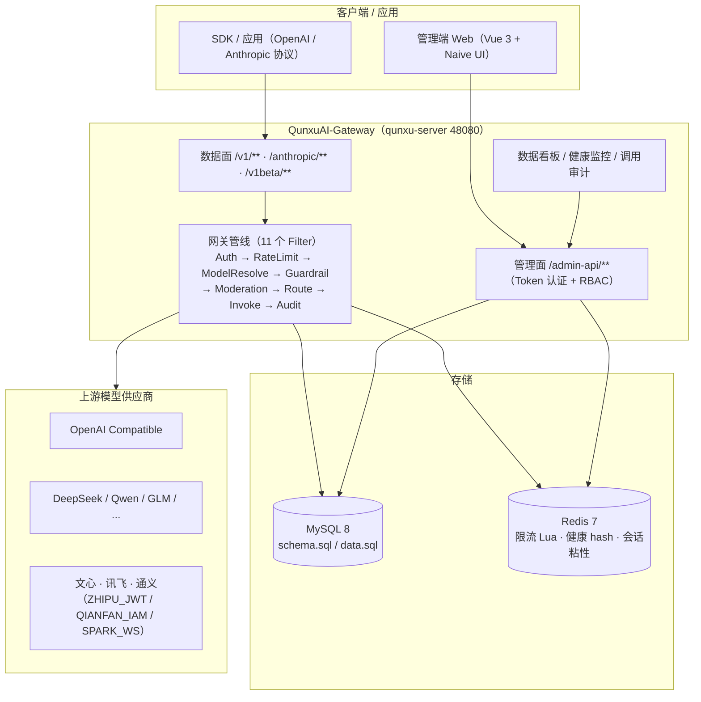

# QunxuAI-Gateway（模型网关）

<p align="center">
  <b>简体中文</b> · <a href="README.en.md">English</a>
</p>

[](LICENSE)
[]()
[]()
[]()
[](https://github.com/QunxuAI/qunxu-ai-gateway)
[](https://hub.docker.com/r/qunxuai/qunxu-ai-gateway)

**QunxuAI-Gateway** 是一个面向大模型应用的**统一模型网关**，自带完整的管理后台（多租户 / 用户 / 权限 / 菜单）：

- **管理面**提供登录、权限、菜单、租户、用户管理等能力，开箱即用；
- **数据面**提供 OpenAI / Anthropic / Gemini / OpenAI Responses 多协议兼容入口，统一路由到国内大模型供应商；
- **前端**基于 Vue 3 + Naive UI，提供数据看板、供应商、逻辑模型、模型通道、健康监控、调用审计、安全策略、限流配额、令牌管理、模型广场等网关管理页面。

> 仓库为单体多模块 Maven 工程；`qunxu-module-gateway` 为模型网关核心模块，`qunxu-server` 为启动入口，`qunxu-ui` 为管理端前端。

---

## ✨ 核心特性

| 特性 | 说明 |
| --- | --- |
| 多协议数据面 | OpenAI（`/v1/**`）、Anthropic（`/anthropic/**`）、Gemini（`/v1beta/models/{model}:generateContent` / `:streamGenerateContent`）、OpenAI Responses（`/v1/responses`） |
| 供应商 / 模型 / 通道 | 供应商凭证（BEARER / ZHIPU_JWT / QIANFAN_IAM / SPARK_WS）、逻辑模型统一对外、通道负载均衡（WEIGHTED_ROUND_ROBIN） |
| 批量上架模型 | 选择供应商后拉取上游 `GET /models` 清单，自动识别能力（CHAT / EMBEDDING / RERANK / TTS / STT / IMAGE），批量创建通道并自动复用同名逻辑模型 |
| 会话级供应商粘性 | 同一会话（调用人 + `X-Session-Id`）固定复用首次选定通道（Redis 绑定 + TTL 自动过期），通道失效自动重绑，避免多轮对话漂移 |
| P0 可逆脱敏 | 围栏脱敏支持 `star`（等长 `*`）与 `placeholder`（`{{PHONE_1}}` 占位符 + 响应本地还原）两种模式，真名实姓只留在内存中 |
| P1 协议感知保护 | Anthropic 思考块（含签名）与 OpenAI `reasoning_content` 自动标记为受保护，围栏 / 内容审计排除、原样保留 |
| 健康自愈 | 通道健康探测（响应式 Redis）、自动剔除 / 恢复（EJECT / RECOVER），健康事件留痕 |
| 安全围栏 | 敏感词（内置种子 + 数据库合并）、PII 脱敏、输入长度、提示注入检测；BLOCK / MASK / WARN 动作 |
| 内容审计 | 内置关键词审计（builtin），预留 aliyun / llm 扩展；BLOCK / REVIEW / PASS |
| 限流配额 | 调用人 / 模型 / 租户维度限流（Redis Lua 令牌桶）+ 每日 Token 配额 |
| 调用审计 | 全量记录 tokens / latency / 首字延迟 / 请求响应体（截断脱敏）/ traceId / 围栏与审计命中 |
| 双视角菜单 | 超级管理员全量管理菜单；普通角色仅见「数据看板 + 令牌管理 + 模型广场」（数据按本人隔离，后端接口层强制） |

## 🏗️ 架构

| 项 | 说明 |
| --- | --- |
| 基础框架 | Spring Boot 4.1.1（Spring Framework 7）、Java 21（LTS）、Maven 多模块 |
| 应用形态 | Servlet（WebMVC）优先；网关保留响应式内部实现（Mono/Flux、WebClient、ReactiveStringRedisTemplate） |
| 网关模块 | `qunxu-module-gateway` 为库模块（无启动类），由 `qunxu-server` 加载；`@MapperScan("tech.qunxu")` 天然覆盖 |
| 数据库 | MySQL 8.0+（dynamic-datasource 主从兼容平铺 `spring.datasource.*`），表结构见 `sql/schema.sql` |
| 缓存 | Redis（响应式），用于健康 hash、限流 Lua 令牌桶、配额、配置失效 pub-sub、会话粘性绑定 |
| 安全 | Token 认证保护 `/admin-api/**`；数据面 `/v1/**`、`/anthropic/**` 由网关 `AuthFilter` 鉴权（`gateway.security.enabled` 默认 false） |

### 整体架构图



### 目录结构

```
QunxuAI-Gateway/
├── LICENSE                         # Apache-2.0 开源协议
├── README.md                       # 本文件（中文）
├── README.en.md                    # English README
├── docs/                           # 设计 / 研究文档、界面截图（docs/images/）
├── docker-compose.yml              # 一键部署编排（MySQL + Redis + 后端）
├── pom.xml                         # 聚合工程（Maven 根）
├── sql/
│   ├── schema.sql                  # ★ 数据库结构（全部建表 DDL）
│   └── data.sql                    # ★ 初始化数据（系统 + 网关种子数据）
├── qunxu-dependencies/             # BOM（依赖版本管理）
├── qunxu-framework/                # 框架 starter（common / security / mybatis / web / redis / jackson）
├── qunxu-module-system/            # 系统模块（用户 / 部门 / 角色 / 菜单 / 字典 / 租户）
├── qunxu-module-gateway/           # ★ 模型网关模块（核心代码）
│   └── src/main/java/tech/qunxu/module/gateway/
│       ├── admin/                  #   管理后台 API（/admin-api/gateway/**）
│       ├── api/                    #   数据面 API（/v1/**、/anthropic/**、gemini、responses）
│       ├── pipeline/               #   网关管线 Filter（认证、限流、围栏、内容审计、审计等）
│       ├── router/                 #   路由与负载均衡（含会话粘性）
│       ├── health/                 #   通道健康探测、自动剔除 / 恢复
│       ├── moderation/guardrail/audit/  #   内容审计、安全围栏、调用审计
│       ├── persistence/            #   MyBatis-Plus 实体 / Mapper
│       └── config/                 #   自动配置
├── qunxu-server/                   # 启动入口（QunxuServerApplication）+ 配置
└── qunxu-ui/                       # 前端（Vue 3 + Vite + TypeScript + Naive UI；Dockerfile + nginx.conf 容器化）
```

## 📸 界面预览

| 登录页 | 数据看板 |
| --- | --- |
|  |  |

| 模型通道管理 | 健康监控 |
| --- | --- |
|  |  |

> 截图来自 `docker compose up` 一键部署后的真实运行界面；更多页面见 README.en.md 或自行部署体验。

## 🚀 快速开始

### ⚡ 方式一：一体化镜像（单容器，最省事）

一个镜像内打包了 **MySQL + Redis + 后端 + 前端（Nginx）** 全部组件，`docker run` 一个容器即可用完整管理后台：

#### 直接拉取（推荐，无需本地构建）

镜像已发布到 Docker Hub，开箱即用：

```bash
docker pull qunxuai/qunxu-ai-gateway:0.1.0

# 运行（只需暴露 80 即可访问前端；48080 为可选的后端直连端口）
docker run -d -p 80:80 -p 48080:48080 --name qunxu-ai-gateway qunxuai/qunxu-ai-gateway:0.1.0
```

#### 本地构建（二次开发场景）

```bash
# 在项目根目录执行（多阶段构建，自动编译后端与前端）
docker build -t qunxu-ai-gateway:0.1.0 -f allinone/Dockerfile .

docker run -d -p 80:80 -p 48080:48080 --name qunxu-ai-gateway qunxu-ai-gateway:0.1.0
```

- 访问 **http://localhost** 即管理后台（Nginx 托管前端并反代 `/admin-api`），默认账号 `admin / admin123`
- 首次启动自动初始化数据库（建表 + 种子数据，幂等，重启不重复执行）
- 数据默认存容器内；可用卷持久化：`docker run -v qunxu-mysql:/var/lib/mysql -v qunxu-redis:/var/lib/redis ...`
- 可自定义环境变量：`MYSQL_PASSWORD`、`GATEWAY_SECURITY_ENABLED`、`GATEWAY_CRYPTO_SECRET` 等
- 镜像文件见 [allinone/](allinone/)（Dockerfile / nginx.conf / supervisord.conf / entrypoint.sh）

### 方式二：Docker Compose 多容器编排

项目根目录已提供 [docker-compose.yml](docker-compose.yml)，编排 **MySQL 8 + Redis 7 + 后端服务 + 前端 Web（Nginx）** 四个容器。

```bash
# 在项目根目录执行
docker compose up -d --build

# 查看启动日志
docker compose logs -f server

# 停止
docker compose down
```

- **管理后台（前端）**：<http://localhost>（Nginx 托管，自动反代 `/admin-api` 到后端）
- **后端 API**：<http://127.0.0.1:48080>；接口文档：<http://127.0.0.1:48080/doc.html>
- 首次启动会自动执行 `sql/schema.sql`（建表）与 `sql/data.sql`（初始化数据），无需手动建库
- 默认账号：`admin / admin123`
- 数据持久化在命名卷 `qunxu-mysql-data`、`qunxu-redis-data`，`docker compose down` 不会删除数据
- 可自定义环境变量（见 [docker-compose.yml](docker-compose.yml)）：`MYSQL_PASSWORD`、`SERVER_PORT`、`WEB_PORT`、`GATEWAY_SECURITY_ENABLED`、`GATEWAY_CRYPTO_SECRET` 等
- 前端也可单独本地运行：`cd qunxu-ui && npm install && npm run dev`（<http://localhost:5180>，vite 代理 `/admin-api` 到 48080）

### 方式三：本地源码运行

#### 环境要求

- JDK 21+（LTS）
- Maven 3.9+
- MySQL 8.0+
- Redis 7+
- Node.js 20+（仅前端）

### 1. 初始化数据库

```bash
# 建库（字符集 utf8mb4）
mysql -uroot -p -e "CREATE DATABASE IF NOT EXISTS \`qunxu_ai\` DEFAULT CHARACTER SET utf8mb4 COLLATE utf8mb4_unicode_ci;"

# 建表 + 初始化数据（sql 目录下）
mysql -uroot -p qunxu_ai < sql/schema.sql
mysql -uroot -p qunxu_ai < sql/data.sql
```

> **说明**：数据库结构由 `sql/schema.sql` 统一维护，初始化数据由 `sql/data.sql` 统一维护；本项目**不使用 Flyway 自动迁移**，改表后请手动执行增量 SQL 或重新导入。

### 2. 修改本地配置

复制并编辑 `qunxu-server/src/main/resources/application-local.yaml`（该文件已被 .gitignore 排除，不会入库），修改数据库与 Redis 连接信息；或通过环境变量注入：

| 变量 | 默认值 | 说明 |
| --- | --- | --- |
| `GATEWAY_SECURITY_ENABLED` | `false` | 数据面是否启用 AuthFilter 鉴权 |
| `GATEWAY_CRYPTO_SECRET` | `qunxu-default-dev-secret-change-me` | 凭证加解密密钥（生产环境务必修改） |

### 3. 启动后端

```bash
mvn -pl qunxu-server -am spring-boot:run
```

启动后：

- 管理端 API：<http://127.0.0.1:48080/admin-api>
- 接口文档：<http://127.0.0.1:48080/doc.html>（Knife4j）

### 4. 启动前端

```bash
cd qunxu-ui
npm install
npm run dev        # http://localhost:5180
```

### 5. 默认账号

| 账号 | 密码 | 角色 |
| --- | --- | --- |
| `admin` | `admin123` | 超级管理员（全部菜单与权限） |
| `test` | `123456` | 普通角色（数据看板 + 令牌管理 + 模型广场，数据按本人隔离） |

### 6. 数据面调用示例

```bash
# 列出可用逻辑模型
curl http://127.0.0.1:48080/v1/models

# 对话补全（透传 OpenAI 格式）
curl -X POST http://127.0.0.1:48080/v1/chat/completions \
  -H "Content-Type: application/json" \
  -d '{"model":"qwen-plus","messages":[{"role":"user","content":"你好"}]}'
```

## 🧪 测试

- 后端：`mvn install`，包含网关单元测试、`@SpringBootTest` 上下文加载、端到端数据面测试（WireMock 上游）与全真实依赖集成测试（`GatewayFullStackIT`，Testcontainers 真实 MySQL + Redis，需本机 Docker；无 Docker 自动跳过）。
- 前端：`npx vue-tsc --noEmit` 类型检查 + `npx vite build` 构建。

## 📄 开源协议

本项目基于 [Apache License 2.0](LICENSE) 开源。自由使用、修改与分发，请保留版权声明。

---

**QunxuAI-Gateway** © 2025 Qunxu AI. All rights reserved.
